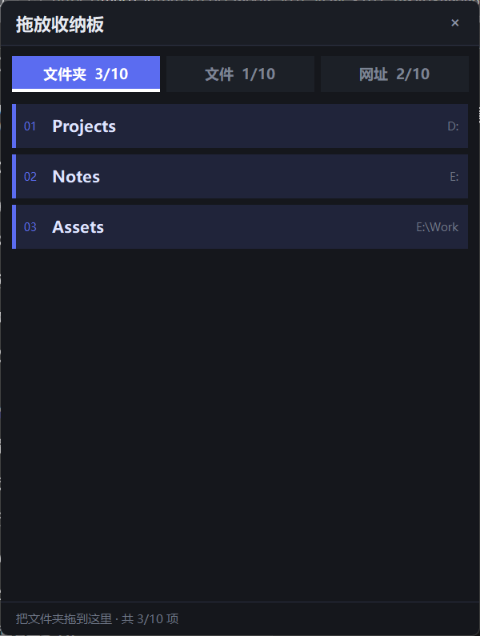
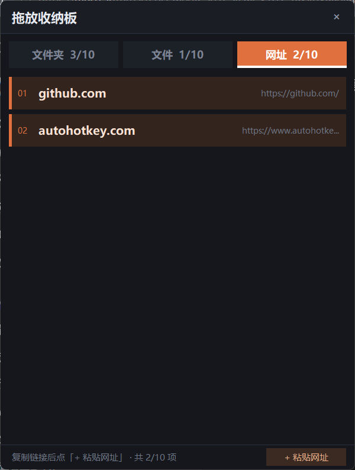
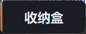

# DropBoard · 拖放收纳板


> 一个常驻桌面小窗，把常用的**文件夹、文件、网址**收成卡片，之后一点就能打开。文件夹和文件直接拖进来，网址复制链接后一键粘贴。

AutoHotkey v2.0+ · Windows 10 / 11 · 单文件 · 零依赖 · 暗色自绘 UI



---

## 它解决什么问题

系统快捷方式和资源管理器收藏夹都不够快：想开一个项目目录、一个常用文档、一个天天看的网页，总得先翻半天。DropBoard 把这些东西收进一个 480×636 的小面板：文件夹和文件**直接拖进去就存好了**，网址在浏览器里 Ctrl+C 复制后点一下按钮，用的时候一下点开，不用的时候双击收成一条「收纳盒」贴在屏幕边上。

## 功能

- **拖放即添加**：把文件夹或文件拖到窗口任意位置，程序自动判断类型，送进对应的标签页。
- **网址用粘贴添加**：浏览器地址栏 Ctrl+C 复制链接，点网址页右下角的「+ 粘贴网址」即可（拖拽链接在多数浏览器里拿不到数据，见「已知限制」）。
- **自动命名**：文件夹取目录名，文件取文件名（去扩展名），网址取域名（去掉 `www.`）。
- **重复检测**：同一个目标再次添加会提示「已存在：xxx（未重复添加）」，不会产生重复卡片。路径比较忽略大小写与末尾斜杠，网址比较忽略协议、`www.` 和末尾斜杠。
- **点击打开 / 已开则激活**：文件夹会去枚举已打开的资源管理器窗口按真实路径精确匹配；文件和网址按窗口记录匹配。已经在看的东西不会再开第二个窗。
- **卡片右键菜单**：打开、重命名、复制路径、删除（删除有确认框）。
- **双击标题栏收起**：缩成 116×46 的小条，只显示「收纳盒」三个字，左侧一道竖条是当前标签页的强调色。再双击展开，**左上角位置不变**。
- **不止一个入口**：除了网址页的按钮，标题栏右键菜单里也有「粘贴网址（剪贴板）」和「手动输入网址…」，在任意标签页都能用。
- **每页上限 10 项**，满了会在状态栏橙色提示，不会静默丢弃。
- **三套配色**：三个标签页各有一套强调色和卡片底色，切页一眼能分清。
- **配置即 JSON**：所有内容存在脚本同目录的 `DropBoard.json`，纯文本，可手工编辑、可版本管理、可备份。窗口位置、当前标签页、是否收起、是否置顶都会记住。

## 界面

| 标签页 | 强调色 | 卡片底色 | 卡片文字 |
| --- | --- | --- | --- |
| 文件夹 |  `#5B6CF0` | `#20243A` | `#DDE3FF` |
| 文件 |  `#19B39E` | `#162E2C` | `#D6F5F0` |
| 网址 |  `#E0713F` | `#33251E` | `#FFE3D4` |

窗口本体背景 `#15171C`，标题栏 `#1A1D24`，边框 `#2B3040`。默认开启窗口置顶。

网址页右下角是「+ 粘贴网址」按钮，状态栏会跟着切到对应提示：



双击标题栏后只剩这么一条，双击它展开：



## 图标

三条横杠对应三个标签页，颜色与界面同源：靛蓝 `#5B6CF0`、青绿 `#19B39E`、橙 `#E0713F`。深底 `#15171C`，四角透明。

`DropBoard.ico` 内含 16 / 32 / 48 / 64 / 128 / 256 六个尺寸，Windows 会按场景自己挑（任务栏用大图、托盘用 16px）。程序启动时读它设置托盘图标和窗口图标；文件缺失时静默跳过，不影响使用。

想改配色或比例，改 `icons/make_icons.py` 顶部的常量后重跑即可（需要 Pillow，生成时用 `py -3`）。

## 快速开始

1. 安装 [AutoHotkey v2](https://www.autohotkey.com/)（v2.0 或更高）。
2. 下载 `DropBoard.ahk` 和 `DropBoard.ico`，放同一个目录，双击 `DropBoard.ahk` 运行。
3. 把几个常用目录拖进窗口；网址就复制链接后点「+ 粘贴网址」。完事。

想把脚本转成独立 exe，用 AutoHotkey 自带的 Ahk2Exe 编译 `DropBoard.ahk` 即可，无需额外文件。

**开机自启**：把脚本（或编译后的 exe）的快捷方式丢进 `shell:startup` 目录。

## 操作一览

| 操作 | 结果 |
| --- | --- |
| 拖入文件 / 文件夹 | 自动分流到对应标签页，可一次拖多个 |
| 复制链接后点「+ 粘贴网址」 | 剪贴板是网址就直接加入，否则弹出输入框手打 |
| 单击卡片 | 打开；如果它已经打开着，则激活那个窗口 |
| 右键卡片 | 打开 / 重命名… / 复制路径 / 删除 |
| 单击标签 | 切换标签页 |
| 双击标题栏 | 收起为「收纳盒」；收起状态下双击整块即展开 |
| 拖动标题栏 | 移动窗口，位置自动记忆 |
| 右键标题栏（或收起态右键） | 收起·展开 / 窗口置顶（带勾）/ 粘贴网址（剪贴板）/ 手动输入网址… / 退出 |
| 点右上角 × | 退出程序 |
| 鼠标悬停卡片 | 状态栏显示完整路径 |

状态栏平时显示当前标签页的提示与计数，操作结果（已添加 / 已存在 / 已满 / 打开失败）会在这里显示 3 秒。

## 配置文件

首次运行后，脚本同目录会出现 `DropBoard.json`，UTF-8 编码。任何增删改和切换标签都会立即写盘，退出时再写一次。

```json
{
  "version": 1,
  "tab": "folder",
  "collapsed": false,
  "topmost": true,
  "window": { "x": 120, "y": 120 },
  "items": {
    "folder": [
      {
        "name": "myhotkey",
        "target": "D:\\soft\\tool\\AutoHotkey\\myhotkey",
        "sub": "D:\\soft\\tool\\AutoHotkey",
        "added": "2026-10-24 22:54"
      }
    ],
    "file": [],
    "url": [
      {
        "name": "github.com",
        "target": "https://github.com/",
        "sub": "https://github.com/",
        "added": "2026-10-24 23:23"
      }
    ]
  }
}
```

| 字段 | 说明 |
| --- | --- |
| `version` | 配置格式版本，目前恒为 `1` |
| `tab` | 启动时选中哪个标签页：`folder` / `file` / `url` |
| `collapsed` | 是否以收起状态启动 |
| `topmost` | 是否窗口置顶 |
| `window.x` / `window.y` | 窗口左上角屏幕坐标 |
| `items.folder` / `items.file` / `items.url` | 三个标签页各自的条目数组 |
| `items.*[].name` | 卡片显示名，可随意改（右键「重命名」就是改它） |
| `items.*[].target` | 真实目标：文件夹路径 / 文件路径 / 网址 |
| `items.*[].sub` | 卡片右侧的副标题，纯显示用。路径的上级目录、文件的「扩展名 + 大小」、网址的完整地址，删掉也能正常读 |
| `items.*[].added` | 添加时间，纯记录。程序不根据它做任何判断，删掉也能正常读 |

手改配置时注意：`name`/`sub`/`added` 缺失会自动补全，`target` 缺失的那条会被跳过。JSON 里 Windows 路径的反斜杠要写成 `\\`。

> 因为配置里存的是本机绝对路径，`.gitignore` 已经把它排除掉了，避免把个人信息推到公开仓库。

## 想改点什么

所有可调参数都在 `DropBoard.ahk` 开头的 `class DropBoard` 里：

| 常量 / 位置 | 作用 |
| --- | --- |
| `static MAX := 10` | 每个标签页的上限 |
| `static W := 480` / `static H := 636` | 展开时的窗口尺寸（逻辑像素，会自动按 DPI 缩放） |
| `static CW := 116` / `static CH := 46` | 收起后的尺寸 |
| `static TABS := [...]` | 三个标签页的 `name`、`hint`、`sub` 以及全部配色（`accent` / `card` / `hover` / `fg`） |
| `MkFont()` 里的 `"Microsoft YaHei UI"` | 字体，换成 `"Segoe UI"` 等即可 |

注意卡片行高、状态栏等坐标是按 `W=480 / H=636` 摆的，改窗口尺寸后需要同步调整 `Render()` 里的位置，不然会错位。

## 实现要点

**为什么整窗自绘。** AutoHotkey v2 的 `Text` 控件已经不支持自定义背景色和文字颜色（`Background` / `c` 选项在 v2 里一律 `Invalid option`），用原生控件做不出三套配色。所以整个界面走 GDI：`CreateCompatibleBitmap` 建一张内存位图，所有元素用 `FillRect` + `DrawTextW` 画进去，最后 `BitBlt` 一次贴到窗口。`WM_ERASEBKGND` 直接返回 1，靠双缓冲避免闪烁。收起 / 展开时重建位图而不是改变窗口裁剪，所以不会发虚。

**DPI。** 启动时调用 `SetProcessDpiAwarenessContext(-4)` 声明 Per-Monitor V2，否则系统会把窗口内容整体拉伸，文字糊掉。所有布局尺寸统一经过 `P(v) => Round(v * A_ScreenDPI / 96)` 换算。

**双击。** Gui 窗口类自带 `CS_DBLCLKS`，双击的第二次按下发的是 `WM_LBUTTONDBLCLK` 而不是 `WM_LBUTTONDOWN`。要同时支持「拖标题栏移动」和「双击标题栏收起」，就得自己接管按下 / 移动 / 抬起三个消息，用 `SetCapture` 跟踪光标，并记录位移超过 2px 才算拖动。`WM_LBUTTONUP` 里另有一层 400ms 内的二次点击判定，兜住某些环境下的消息顺序差异；`WM_MOUSEMOVE` 里再用 `GetKeyState("LButton", "P")` 检查左键是否真的还按着，防止松手消息丢失后窗口被鼠标到处拽。

**JSON。** 没引第三方库，文件尾部自带一个最小解析器（对象 / 数组 / 字符串转义 / 数字 / 字面量），写盘时手工拼接以保持键顺序和缩进可读。

**图标。** 托盘图标用 `TraySetIcon`，窗口图标走 `WM_SETICON` 发两个消息（`ICON_SMALL` 16px、`ICON_BIG` 48px，后者供任务栏和 Alt+Tab）。`LoadImage` 带 `LR_LOADFROMFILE | LR_SHARED`，句柄由系统托管，不需要自己 `DestroyIcon`——否则窗口销毁时容易漏释放。

**打开与激活。**

- 文件夹：通过 Shell COM（`Shell.Application` 的 `Windows` 集合）枚举已打开的资源管理器窗口，用 `Document.Folder.Self.Path` 拿到真实路径做比较。这是唯一可靠的办法——窗口标题会随视图变化，不可靠。
- 文件：先查本次运行记录下来的窗口句柄，再按文件名（去扩展名、长度 ≥3 字符）在窗口标题里模糊匹配。
- 网址：先查窗口记录，再按域名匹配 Chrome / Edge / Firefox 窗口标题。

## 已知限制

- **网址拖动不了，这不是 bug。** 浏览器拖一个链接到外部程序时，给的通常只是纯文本（`text/uri-list` / `text/plain`），并不提供 `CF_HDROP` 文件数据，所以走 `WM_DROPFILES` 的窗口根本收不到这个拖放。要让网址也能拖进来，得自己实现 COM 的 `IDropTarget` 接口去接文本格式，代码量比现在整个界面还大。目前的做法是：复制链接，点「+ 粘贴网址」，一次点击的成本其实更低。
- **网址无法精确到浏览器标签页。** 多标签共用一个窗口，程序能激活那个浏览器窗口，但没法切到具体那一个标签。要做到标签级得用 UI Automation 读地址栏，代价和稳定性都不划算。
- **文件按标题模糊匹配**，文件名太短（<3 字符）会跳过匹配直接打开，避免误激活别的窗口。同名文件可能互相误判。
- **没有键盘操作。** 全自绘窗口没有原生控件，`Tab` 焦点、键盘导航都没有，只有鼠标。
- **配置文件必须可写。** 脚本放在 `Program Files` 之类无写权限的目录时，配置会保存失败；建议放在自己的目录里。
- **未签名。** 首次运行 SmartScreen 可能提示未知发布者，选「更多信息 → 仍要运行」。
- Windows 11 上通过 `DwmSetWindowAttribute` 加了圆角；Windows 10 上这个调用会失败，但已被 `try` 包住，不影响使用。

## 目录

```
DropBoard.ahk    # 全部代码，单文件
DropBoard.ico    # 应用图标，16–256 六个尺寸
DropBoard.json   # 首次运行自动生成，本地配置（已 gitignore）
README.md
LICENSE
docs/            # README 用截图
icons/           # 图标源代码与生成脚本
```

## 许可

[MIT](LICENSE) © 2026 Godone
